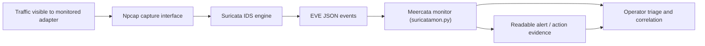
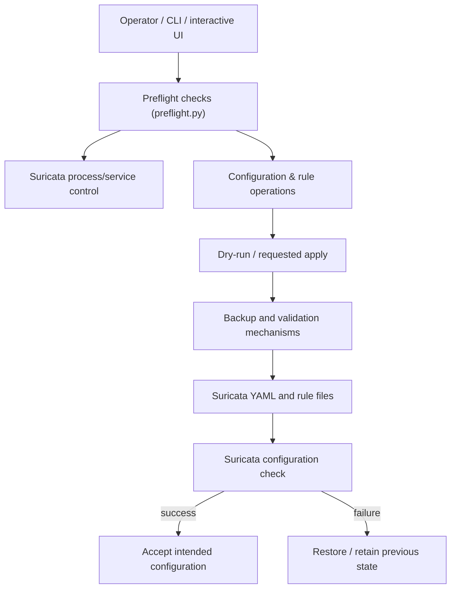

# Meercata Architecture and Trust Boundaries

**Scope of this document:** Source-informed description of the published `Meercata-v1.00-Windows/` project, not an independently verified deployment diagram. Suricata performs packet analysis; Meercata manages and observes the deployment.

## Passive Windows IDS data path

**Boundary:** The monitor sees events Suricata writes, not every packet on the network. In particular, absence of an EVE alert is not evidence that no attack occurred. An EVE action field is Suricata's reported interpretation; preventing a packet requires separate validation of an inline enforcement path.

## Control and configuration path

The documented Windows workflow uses `meercata.cmd check` and `meercata-admin.cmd`. Changes requiring privileged access need an Administrator session. Code and documentation include preflight checks for Suricata, Npcap, selected interfaces, permissions, and build-dependent features.

The diagram represents the **documented intended workflow**. To establish effectiveness, execute and retain tests showing backup creation, validation failure behavior, and successful recovery, including negative cases.

## Components and files

| File / component | Responsibility | Boundary to verify |
| --- | --- | --- |
| `main.py` | CLI and interactive orchestration | Operator intent, safe defaults, command parsing |
| `preflight.py` | Requirement checks and feature gating | Missing binaries, privileges, invalid interface, build capabilities |
| `suricata_ctl.py` | Suricata process/service operation | Service state, restoration, interruption, command execution |
| `suricatamon.py` | EVE monitoring, event formatting, basic domain context | Malformed data, log rotation, duplicates, stale associations |
| `yaml_tools.py` | Suricata configuration helpers | Data integrity, changes, rollback, file permissions |
| `platform_support.py` | OS-specific paths, binaries, environment discovery | Windows-specific assumptions |
| `Meercata-v1.00-Windows/tests/` | Unit-level regression coverage | Unit tests do not replace real capture or inline packet tests |

## Evidence interpretation rules

1. **Alert:** A Suricata signature matched its input. It does **not** alone demonstrate exploit success, malware execution, or compromise.
2. **Allowed alert:** An EVE alert with an allowed action must not be counted as a blocked flow.
3. **Suricata-reported drop:** A drop-style event suggests an enforcement decision was reported. Verify actual packet disposition and connection behavior separately.
4. **DNS / TLS / HTTP domain context:** A domain associated with an IP may reflect shared hosting, historical DNS, SNI, proxies, or cache state. Treat it as an investigative lead.
5. **Service healthy:** A running service is not proof that useful traffic is being captured or rules are effective.
6. **Rules loaded:** Loaded signatures are not proof of coverage for a specific threat without a relevant test.

## Platform constraints

**Windows v1.00:** Passive Npcap/pcap IDS is the release's stated validated mode. The codebase describes a WinDivert-dependent IPS command; that capability is conditional on the local Suricata build and requires independent inline testing.

**Linux v2:** Investigate separately. NFQUEUE, nftables/iptables, firewall state and fail-open behavior belong to a different operating environment and should not be inferred from Windows results.

## Assumptions and known gaps to investigate

- Sensor location and adapter selection determine which east-west or north-south flows can actually be observed.
- Network encryption limits the content available to signature inspection.
- Event enrichment cache associations can age or become misleading.
- Privilege, log access, retention, and clock synchronization affect incident reconstruction.
- No benchmark of CPU, memory, packet loss, alert quality, or inline blocking is established by this document.

For reproducible experiments, use the [validation plan](VALIDATION_PLAN.md). For a distinction between implemented and validated claims, use the [research log](RESEARCH_LOG.md).
